# Tài liệu Schema CSDL — fb-traffic

> **Nguồn:** dựng từ các file migration trong `supabase/migrations/` (legacy `001–010` đã bị thay thế bởi `011`; sau đó `012 → 039`). **Chưa đối chiếu với DB đang chạy** (project Supabase của app, ref `pnbebl…`, không truy cập được từ phiên viết tài liệu này). Trước khi bàn giao nên chạy kiểm tra ở mục 9.
> Ngày lập: 23/10/2026. Nhãn: `UNKNOWN` = không xác định được từ code · `NOT VERIFIED` = chưa kiểm trên DB thật.

## 1. Tổng quan

- Nền tảng: Supabase (Postgres 17). Truy cập từ app **chỉ qua `service_role`** (`src/lib/supabase/admin.ts`, biến `SUPABASE_SECRET_KEY`); `anon`/`authenticated` bị `REVOKE` hết trên 5 schema tuỳ chỉnh, **RLS bật trên mọi bảng, không có policy nào** → client trình duyệt không đọc được bảng. Phân quyền theo vai trò làm ở tầng ứng dụng (`requireUser` / `requireActionUser`).
- Chỉ `auth.users` (Supabase Auth) và Storage nằm ngoài 5 schema.
- Trigger `core.touch_updated_at()` tự gắn cho **mọi bảng có cột `updated_at`** (011) và gắn thêm cho các bảng tạo ở 015/016.
- Múi giờ nghiệp vụ: `Asia/Ho_Chi_Minh` (ngày của bài đăng tính theo giờ VN).
- **Có 2 database:**
  1. **DB của app** (tài liệu này) — schema `core`, `social`, `sales`, `rnd`, `private`.
  2. **DB đơn hàng ngoài "Qlydonhang"** (project riêng, ref `loslxuontvsrdmnqxcmm`, truy cập qua `ORDERS_SUPABASE_URL` + `ORDERS_SUPABASE_SECRET_KEY`) — app **chỉ đọc**: RPC `fb_product_daily_sales*`, `fb_product_catalog*` (SQL nguồn lưu ở `supabase/qlydonhang/001–007`, chạy tay trên project đó) và bảng `orders.sapo_tags` (`src/lib/team-tags.ts`). Có thể thay bằng REST API khi đặt `SALES_API_URL` (`src/lib/sales-api.ts`). Schema của DB này **không thuộc phạm vi tài liệu** → `UNKNOWN`.

| Schema | Vai trò | Số bảng |
|---|---|---|
| `core` | Người dùng, team, cấu hình, nhật ký đồng bộ | 4 |
| `social` | Kênh mạng xã hội, bài đăng, số liệu theo ngày | 5 |
| `sales` | Danh mục sản phẩm, số bán theo ngày, tồn kho | 5 |
| `rnd` | Quy trình R&D (P0–P6), test, đánh giá, bàn giao | 16 |
| `private` | Token (Meta, TikTok) — không ai ngoài hàm `security definer` đọc được | 2 |

## 2. Sơ đồ quan hệ (ERD rút gọn)

```mermaid
erDiagram
  "auth.users" ||--|| "core.profiles" : id
  "core.teams" ||--o{ "core.profiles" : team_id
  "core.teams" ||--o{ "social.channels" : team_id
  "core.teams" ||--o{ "rnd.products" : team_id
  "core.teams" ||--o{ "rnd.handoffs" : team_id
  "social.channels" ||--o{ "social.posts" : channel_id
  "social.channels" ||--o{ "social.channel_daily" : channel_id
  "social.channels" ||--o| "private.channel_tokens" : channel_id
  "social.channels" ||--o| "private.tiktok_tokens" : channel_id
  "social.posts" ||--o{ "social.post_daily" : post_id
  "social.posts" ||--o{ "social.post_links" : post_id
  "rnd.products" ||--o{ "social.post_links" : "product_id (không FK)"
  "rnd.goals" ||--o{ "rnd.kpi_templates" : goal_code
  "rnd.products" ||--o{ "rnd.test_sessions" : product_id
  "rnd.products" ||--o| "rnd.evaluations" : product_id
  "rnd.products" ||--o{ "rnd.decisions" : product_id
  "rnd.products" ||--o{ "rnd.handoffs" : product_id
  "rnd.handoffs" ||--o{ "rnd.handoff_events" : handoff_id
  "rnd.products" ||--o| "rnd.design_tasks" : product_id
  "rnd.products" ||--o{ "rnd.sample_orders" : product_id
  "rnd.products" ||--o{ "rnd.media_requests" : product_id
  "rnd.sample_orders" ||--o{ "rnd.media_requests" : sample_order_id
  "rnd.products" ||--o| "rnd.product_metrics" : product_id
  "rnd.products" ||--o{ "rnd.product_code_links" : product_id
  "rnd.products" ||--o{ "rnd.commercial_reviews" : product_id
  "rnd.products" ||--o{ "rnd.product_events" : product_id
  "sales.inventory_imports" ||--o{ "sales.inventory_stock" : import_id
```



Liên kết **không có khoá ngoại** (logic, theo mã): `sales.daily_sales.code` / `sales.catalog.code` / `sales.inventory_stock.code` ↔ `rnd.products.code|sapo_code` ↔ `social.posts.product_codes[]` (mã SPU dạng `^[A-Z]{1,4}[0-9]{3,}$`, ví dụ `D0008`, `N0123`, mã test `T10001`).

## 3. Schema `core`

### `core.profiles` — người dùng (mở rộng `auth.users`)
| Cột | Kiểu | Ghi chú |
|---|---|---|
| `id` | uuid PK | FK → `auth.users(id)` ON DELETE CASCADE |
| `email` | text NOT NULL | |
| `full_name` | text NOT NULL | |
| `role` | text NOT NULL | CHECK ∈ `admin, rnd, design3d, media` (018). Giá trị cũ `saobien` đã gộp vào `rnd`; code vẫn chấp nhận `saobien` qua `normalizeRole` |
| `is_active` | boolean NOT NULL default true | `false` = khoá tài khoản; `getCurrentUser` trả null |
| `team_id` | uuid | FK → `core.teams` ON DELETE SET NULL (015) |
| `is_team_lead` | boolean NOT NULL default false (015) | |
| `approved_at` | timestamptz (037) | null = chờ quản lý duyệt tài khoản đăng ký mới |
| `created_at`, `updated_at` | timestamptz | |

### `core.teams`
`id` uuid PK · `name` text UNIQUE · `is_active` bool · `created_at`/`updated_at`. Seed: Hồng Ngọc, Global, Đá quý, HLB, NLB (015), BOD (016).

### `core.settings` — cấu hình key/value (jsonb)
`key` text PK · `value` jsonb · `updated_by` → profiles · `updated_at`.
Khoá đang dùng (theo code):
| key | Nội dung | Nơi dùng |
|---|---|---|
| `hashtag_rules` | mẫu regex nhân sự `^k[0-9]{3}$`, dòng nội dung `^a[1-5]$`, concept `c`=old / `m`=new | `lib/tags.ts` |
| `category_prefix` | chữ cái đầu mã → loại SP (M mặt dây, D dây chuyền, N nhẫn, L lắc, K kiềng, B bông tai, C charm, Q đá quý) | `lib/tags.ts` |
| `evaluation` | cửa sổ test & phân loại mới/cũ (`window_days 14`, `new_lookback_days 90`, `new_max_qty 3`, `new_catalog_days 30`, `catalog_trusted_from`, `history_trusted_from`, `old_hot_qty 30`) | `lib/eval/*` |
| `rnd_options` | tuỳ chọn danh mục R&D (trạng thái đơn đặt, loại yêu cầu media… — cấu hình được) | `lib/pipeline.ts`, `lib/rnd-options.ts` |
| `spu_rules` | ngưỡng phân loại SPU: Ngôi sao, bán chậm, tồn xấu | `lib/spu-rules.ts` |
| `commercial_rules` | ngưỡng thương mại hoá (`opsRatePct`, `minMarginPct`, `maxBreakEvenDays`, `maxReturnPct`, `safetyDays`, `defaultLeadDays`, `minDataDays`, `minDataQty`) | `lib/commercial-eval.ts` |
| `grid:<userId>:<bảng>` | tuỳ chọn hiển thị bảng của từng user (≤ 20 KB) | `grid-prefs-actions.ts` |

### `core.sync_runs` — nhật ký đồng bộ
`id` bigint identity PK · `job` text (`setup/channel/sales/catalog/retag/evaluate`…) · `channel_id` text · `status` ∈ success/error · `message` · `started_at` · `finished_at`. Index: `started_at desc`, `(job, channel_id, started_at desc)`. Hàm dọn: `core.prune_sync_runs(keep_days=90)`.

## 4. Schema `social`

### `social.channels` — kênh (Page FB, IG, TikTok, YouTube)
| Cột | Kiểu | Ghi chú |
|---|---|---|
| `id` | text PK | ID kênh trên nền tảng |
| `platform` | text | CHECK ∈ facebook, instagram, tiktok, youtube |
| `name`, `username` | text | |
| `parent_id` | text | FK → channels (IG → Page FB), SET NULL |
| `followers_count` | bigint | |
| `staff_code` | text | "(sau này) kênh thuộc nhân sự nào" |
| `is_active` | bool default true | |
| `token_source` | text | CHECK ∈ system, user (014) — token phát hiện kênh |
| `last_seen_at` | timestamptz (014) | lần cuối token còn liệt kê kênh |
| `team_id` | uuid → core.teams (015) | |
| `last_synced_at` | timestamptz (020) | cho sync xoay vòng |
| `is_rnd` | bool default false (022) | kênh dùng cho R&D |
Index: `(platform) where is_active`, `(last_synced_at nulls first) where is_active`, `(is_rnd) where is_rnd and is_active`.

### `social.channel_daily` — số liệu kênh theo ngày
PK `(channel_id, date)` · `views, viewers, engagements, new_follows, unfollows, page_views, video_views` (bigint default 0) · `updated_at`. Index `date`.

### `social.posts` — bài đăng
`id` text PK · `channel_id` FK CASCADE · `platform` · `published_at` · `kind` ∈ reel/video/photo/status/other · `message`, `permalink_url`, `thumbnail_url` · `hashtags text[]` · `product_codes text[]` (chỉ mã có trong `sales.catalog`/`rnd.products`) · `unknown_codes text[]` · `content_line` (A1–A5) · `concept` ∈ old/new · `staff_code` (K301) · `views, viewers, reactions, clicks, video_views` bigint default 0 · `comments`, `shares` bigint (null = chưa có quyền đọc) · `stats_at`.
Index: `(channel_id, published_at desc)`, `(published_at desc)`, GIN `product_codes`, GIN `unknown_codes` (khi không rỗng), `(published_at, id) where product_codes<>'{}'` (036), `(channel_id, published_at desc) where kind in (video, reel)` (036).

### `social.post_daily` (024, 026)
PK `(post_id, date)` · `views, reactions, viewers, clicks` bigint · FK → posts CASCADE · index `date`. Ảnh chụp số liệu bài theo ngày (cho cửa sổ test). Dọn bởi `lib/sync/snapshots.ts` (`pruneSnapshots`).

### `social.post_links` (023)
PK `(post_id, product_id)` · `linked_by` uuid · `created_at`. `product_id` = `rnd.products.id` **không có FK** (khác schema). Gắn tay bài đăng ↔ mẫu R&D. *Lưu ý:* commit `c3f2306` ghi "drop manual product linking" — bảng còn trong schema, code vẫn tham chiếu 4 chỗ (`.from("post_links")`) → mức độ sử dụng hiện tại `NEEDS VERIFICATION`.

## 5. Schema `sales`

### `sales.catalog` — danh mục mã SPU (đồng bộ từ đơn hàng)
`code` text PK · `name` · `image_url` · `base_masp` (SKU đại diện, vd `D0008-00-S-WH`) · `first_seen_at` (tin được từ 2026-08) · `updated_at`.

### `sales.daily_sales` — số bán theo ngày
PK `(code, date, page_id, channel)` · `qty_sold`, `qty_returned` integer default 0 · `page_id` text default '' (Trang nguồn; hoặc ID kênh TikTok sau khi ghép) · `channel` ∈ facebook, tiktok_shop, shopee, web, cua_hang, zalo, instagram, bao_hanh, khac · `updated_at`. Index `(page_id, date) where page_id<>''`, `(date)`.
> Migration **028 đã DROP** các cột `revenue, returned_value, cost, returned_cost` (quyết định không lưu tiền). Xem cảnh báo mục 8 (#1).

### `sales.tag_aliases` (032)
`tag` PK · `alias_name` · `hits` int default 1 · `source` default 'orders' (orders | api) · `updated_at`. Tra tag gốc trên đơn Sapo → tên tài khoản (TikTok).

### `sales.inventory_imports` (038)
`id` uuid PK · `file_name` · `row_count` · `skipped` · `created_by` → profiles · `created_at`. Lịch sử import Excel tồn kho (`lib/inventory-import.ts`, thư viện `xlsx`).

### `sales.inventory_stock` (038, 040)
PK `(code, warehouse)` · `code` CHECK `^[A-Z]{1,4}[0-9]{3,}[A-Z0-9-]*$` · `stock` int ≥ 0 · `last_in_date` date · `import_id` → inventory_imports (SET NULL) · `updated_at`. Index `warehouse`, `import_id`.
**043** *(chưa chạy)*: lưu theo từng SKU — thêm `sku` (NOT NULL), khoá chính đổi thành `(sku, warehouse)`, `code` = mã SPU của SKU (phần trước dấu `-` đầu tiên) để gộp khi xem; thêm bảng `sales.inventory_skus(sku PK, code, import_id, updated_at)` chứa TẤT CẢ SKU của file (kể cả SKU hết hàng ở mọi kho). **042**: thêm `incoming` (hàng đang về), gỡ ràng buộc dạng mã `code`.
Thêm ở **040** *(file đã tạo, CHƯA chạy, code chưa dùng)*: `start_date` date (tuổi tồn FIFO theo mã) · `is_floor` bool default false (mốc sàn 2025-09-08/09) · `warehouse_id` text (sapo_location_id).

## 6. Schema `rnd`

### `rnd.products` — mẫu sản phẩm (bảng trung tâm)
| Nhóm | Cột |
|---|---|
| Định danh | `id` uuid PK · `code` text UNIQUE NULL, CHECK `^[A-Z]{1,4}[0-9]{3,}$` (null cho đến khi gắn mã SPU/test) · `st_code` text UNIQUE (mã sưu tầm, trigger tự cấp `VST0001…` khi có `stage`; seq `rnd.vst_seq`) · `sapo_code` · `archived_code` · `merged_into` → products |
| Mô tả | `name`, `line`, `category`, `material`, `stone`, `size`, `description`, `image_paths text[]` (bucket `rnd-images`), `source_url`, `source_status` |
| Trạng thái | `status` ∈ researching/testing/ended · `origin` ∈ manual/auto (011) · `age_override` ∈ new/old · `entry_source` ∈ rnd/media (017) |
| Quy trình | `stage` ∈ **p0…p6** (030; null = mã tự động, ngoài quy trình) · `stage_at` · `approval` ∈ draft/pending/approved/rejected · `approved_by/at/note/qty` · `team_id` · `killed_at` · `kill_reason` |
| Sưu tầm | `ref_url`, `ref_platform`, `ref_metrics`, `price_ref`, `product_group` ∈ gmv/traffic/profit/return, `expected_cost`, `expected_price`, `win_qty` |
| Traffic/vòng đời | `traffic_owner`, `customer_feedback`, `ads_cost`, `traffic_review`, `traffic_note`, `launch_date`, `lifecycle_review`, `lifecycle_note` |
| Media review | `media_review` ∈ accepted/dismissed, `media_review_by/at/note` |
| Thương mại hoá (039) | `video_cost`, `ops_cost`, `lead_days`, `min_order_qty` (CHECK ≥ 0 / ≥ 1) |
| Chung | `created_by`, `updated_by`, `created_at`, `updated_at` |
Index: status, `sapo_code` (not null), `stage` (not null), `team_id` (not null), `merged_into` (not null). Trigger: `products_st_code` (BEFORE INSERT/UPDATE OF stage), `touch_updated_at`.

### `rnd.product_events` — nhật ký thay đổi
`id` identity PK · `product_id` FK CASCADE · `actor_id` · `action` (`stage_changed`, `source_taken`…) · `changes jsonb` `{field:[cũ,mới]}` · `created_at`. Index `(product_id, created_at desc)`.

### `rnd.status_log` (016)
`entity` (order/design/media/product) · `entity_id` text · `value` · `actor_id` · `at`. Lịch sử đổi trạng thái để tính thời gian từng công đoạn.

### `rnd.goals` / `rnd.kpi_templates`
- `goals`: `code` PK (`^[a-z][a-z0-9_]*$`) · `name` · `description` · `win_result` ∈ win/win_traffic · `sort_order` · `is_active`. Seed: sales, traffic, concept, content; thêm `test` (019).
- `kpi_templates`: `id` uuid · `name` · `goal_code` FK · `line`, `campaign` · `rules jsonb` (mảng `{metric, op (>=|<=), value}`) · `match` all/any · `min_days` · `min_views` · `duration_days` · `is_default` · `is_active`. UNIQUE index 1 mặc định / mục tiêu (`where is_default`). Metric hợp lệ: `views, viewers, reactions, clicks, qty_net, ctr, engagement_rate, conversion` (theo `lib/kpi-constants`).

### `rnd.test_sessions`
Phiên test của mẫu: `product_id` · `goal_code` · `template_id` · `campaign` · `start_date`/`end_date` (CHECK end ≥ start) · `sales_scope` ∈ all/pages/channels · `page_ids[]` · `channels[]` · `rules`/`match`/`min_days`/`min_views` (chụp KPI lúc bắt đầu) · `status` ∈ running/ended · `ended_at` · `note`. UNIQUE `(product_id) where status='running'`.

### `rnd.evaluations` — kết quả chấm tự động (1 dòng/mã)
PK `code` · `product_id` · `first_post_date`, `window_end`, `days_elapsed` · `age` ∈ new/old, `age_reason`, `age_reliable` · `source` ∈ auto/session · `session_id` · `result` ∈ testing/win/win_traffic/win_sp/fail (CHECK 019; `win_sp` là giá trị cũ, không còn tạo mới) · `sales_status`, `traffic_status` (pass/partial/weak/not_enough) · `metrics`, `checks`, `forecast`, `videos` (jsonb) · `evaluated_at`.

### `rnd.decisions` + view `rnd.current_decisions`
`decisions`: lịch sử xác nhận kết quả bởi người: `product_id`, `session_id`, `result` ∈ win/win_traffic/win_sp/fail, `suggested`, `note`, `snapshot jsonb`, `decided_by/at`. View `current_decisions` (security_invoker) = quyết định mới nhất mỗi mẫu (`distinct on (product_id)`).

### `rnd.handoffs` / `rnd.handoff_events`
`handoffs`: bàn giao mẫu Win cho team: `product_id`, `decision_id`, `result` (nullable từ 033), `snapshot` (default `{}`), `source_url` (nullable), `rnd_note`, `status` ∈ pending/received/developing/done/returned, `assignee_id`, `saobien_note`, `team_id`, `deadline`, mốc `received_at/done_at`. UNIQUE `(product_id, coalesce(team_id, nil-uuid)) where status<>'returned'` (034: 1 bàn giao mở / mẫu / team). Index `(team_id, status)`, `(team_id) where status='pending'`.
`handoff_events`: nhật ký (`action`, `note`, `actor_id`).

### `rnd.design_tasks` (P2 — Thiết kế 3D)
PK `product_id` · `assignee_id` · `status` ∈ todo/doing/review/redo/done · `file_url` · `image_paths[]` · `note`, `review_note`, `reviewed_by` · `submitted_at`, `done_at`.

### `rnd.sample_orders` (P2 — đặt mẫu)
`id` identity · `product_id` · `supplier` · `status` text (đã bỏ CHECK ở 016; giá trị theo cấu hình `rnd_options.order_status`, mặc định "Đặt hàng / Chốt đúc / Quay chế tác / Hoàn thành / Huỷ") · `ordered_at`, `expected_at`, `received_at` · `qty`, `unit`, `weight_chi`, `size`, `color` · `cost` (chi phí SX), `cost_other`, `price`, `note`.

### `rnd.media_requests` (016 — thay `media_tasks`, đã DROP)
`id` identity · `product_id` · `sample_order_id` · `request_type` text default 'Quay sản phẩm' (có thể nhiều loại phân cách dấu phẩy) · `assignee_id`, `lead_id` · `deadline` · `status` ∈ todo/doing/done · `drive_url` · `photo_paths[]` · `approval` ∈ pending/pass/redo · `review_note`, `reviewed_by` · `note` · `received_at`, `done_at` · `created_by` (null = tạo tự động).

### `rnd.product_metrics` (031)
PK `product_id` · `code` · `since` · `posts, videos` int · `views, viewers, reactions, clicks` bigint · `qty_net` int · `daily_qty int[]` (30 ngày) · `refreshed_at`. Cache số liệu để hiển thị bảng nhanh; làm mới bởi `lib/rnd-metrics.ts` (`refreshProductMetrics`).

### `rnd.product_code_links` (035)
Gắn mã test ↔ mã SPU thương mại: `product_id`, `test_code` (vd T10001), `sku_code` UNIQUE (CHECK định dạng), `launch_date` (trước = test, từ ngày đó = thương mại), `note`, `created_by`.

### `rnd.commercial_reviews` (039)
Duyệt thương mại hoá: `product_id`, `decided_by/at`, `decision` ∈ approve/reject, `suggestion` ∈ approve/conditional/reject (gợi ý của hệ thống), `approved_qty`, `note`, `snapshot jsonb`.

## 7. Schema `private` và Storage

- `private.channel_tokens(channel_id PK→channels CASCADE, access_token, updated_at)` — Page Token Meta.
- `private.tiktok_tokens(channel_id PK, open_id, access_token, refresh_token, access_expires_at, refresh_expires_at, scope, updated_at)`.
- Chỉ đọc/ghi qua hàm `security definer`: `social.channel_tokens()`, `social.save_channel_token()`, `social.tiktok_tokens()`, `social.save_tiktok_token()`.
- **Storage bucket** `rnd-images`: private, giới hạn 10 MB, MIME jpeg/png/webp/heic (tạo ở legacy `006`; `NOT VERIFIED` còn tồn tại sau khi chuyển v2). Upload qua signed URL (`lib/media.ts`). Ảnh/ video cũng có thể lên Cloudinary (`CLOUDINARY_URL`, script `migrate-images-to-cloudinary.mjs`).

## 8. Hàm / RPC

| Hàm | Mục đích |
|---|---|
| `core.touch_updated_at()` | trigger cập nhật `updated_at` |
| `core.prune_sync_runs(keep_days)` | xoá nhật ký cũ |
| `rnd.assign_st_code()` | trigger cấp `VST####` |
| `rnd.link_code(p_id, p_code)` *(security definer)* | gắn mã vào mẫu R&D; gộp/lưu trữ mẫu tự động trùng mã (bản mới nhất ở 017) |
| `social.channel_tokens()`, `save_channel_token()`, `tiktok_tokens()`, `save_tiktok_token()` | đọc/ghi token |
| `social.channel_totals(ids, from, to)` | tổng số liệu kênh |
| `social.post_stats_at(post_ids, day)` | số liệu bài tại ngày (bản chụp gần nhất ≤ ngày) |
| `sales.code_sales(codes, from, to, page_ids, channels)` | SL bán thuần theo mã (loại kênh `bao_hanh` khi không chỉ định kênh) |
| `sales.code_sales_by_channel(code, from, to)` | SL bán thuần theo kênh |
| `sales.page_sales(page_ids, from, to)` | SL bán thuần theo Trang |
| `sales.product_report(...)`, `sales.sales_report_all(...)`, `sales.returns_only(...)` | báo cáo traffic × bán (bản 028, không tiền) |
Tất cả `GRANT EXECUTE` chỉ cho `service_role`.

## 9. Điểm cần lưu ý / xác minh trước khi bàn giao

1. **POSSIBLE BUG — `src/lib/commercial-eval.ts:60`** vẫn `select("date, qty_sold, qty_returned, revenue, returned_value, cost, returned_cost")` từ `sales.daily_sales`, nhưng migration `028_drop_money.sql` đã xoá 4 cột tiền. Nếu DB đã chạy 028 thì truy vấn lỗi/rỗng → tính "giá bán thực tế" (dòng 78) sai/không có. Kiểm tra: `select column_name from information_schema.columns where table_schema='sales' and table_name='daily_sales'`. Đồng thời `SHOW_FINANCE=false` (`lib/features.ts`) đang ẩn mọi cột tiền trên UI.
2. **Thiếu migration `027`** (dãy nhảy 026 → 028) và `001–010` nằm trong `migrations/legacy/` (đã bị 011 DROP). Có hai file đánh số `017` (`017_link_code_history`, `017_media_flow`) — thứ tự chạy giữa hai file phụ thuộc tên, không xung đột cột.
3. **Migration chạy tay** (không có CLI tự động): xác nhận đã chạy đủ 011 → 039 trên DB thật: `select * from supabase_migrations.schema_migrations` *(nếu có)* hoặc kiểm tra từng cột/bảng mới.
4. **Bảng chưa thấy nơi dùng / `NEEDS VERIFICATION`:** `social.post_links` (xem mục 4), `rnd.status_log` chỉ ghi, `core.settings.rnd_options` không có trong seed migration (tạo khi lưu cấu hình lần đầu).
5. **`core.profiles.role`:** CHECK chỉ cho phép 4 giá trị, trong khi code còn xử lý `saobien` — chỉ để tương thích dữ liệu cũ.
6. **Truy vấn kiểm tra nhanh** DB thật:
   ```sql
   select table_schema, table_name from information_schema.tables where table_schema in ('core','social','sales','rnd','private') order by 1,2;
   select schemaname, tablename, count(*) pol from pg_policies where schemaname in ('core','social','sales','rnd','private') group by 1,2;  -- kỳ vọng: 0 policy
   select n.nspname, p.proname from pg_proc p join pg_namespace n on n.oid=p.pronamespace where n.nspname in ('core','social','sales','rnd');
   ```
7. Policy RLS: **không có policy nào** theo migration (an toàn vì chỉ `service_role` truy cập). `NOT VERIFIED` trên DB thật.
